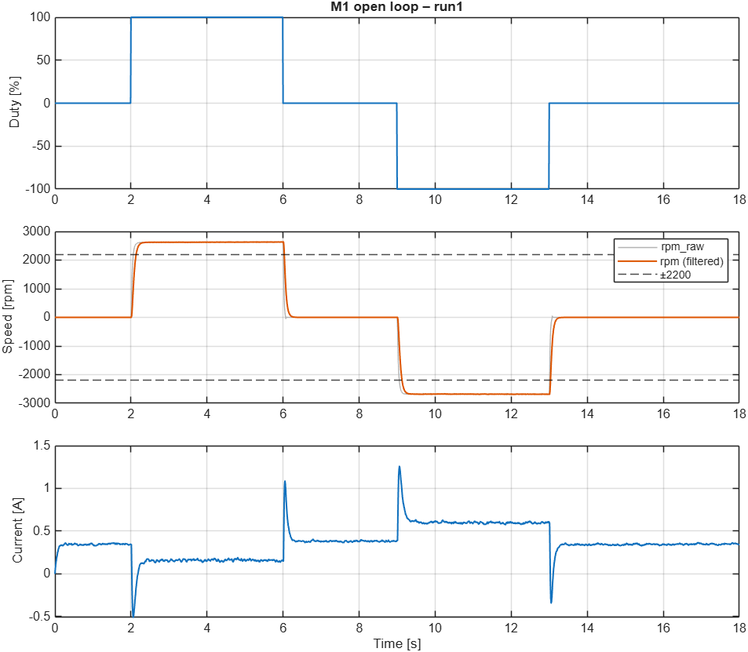
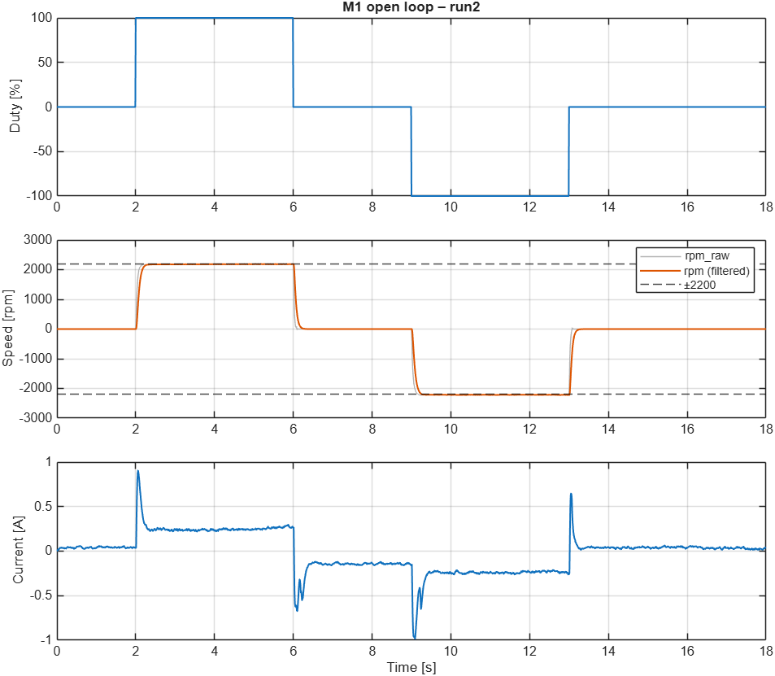

# M1 – Open-loop test and sensor calibration

**Model:** `01_Implementation/DCMotor_M1_OpenLoop.slx`
**Analysis:** `01_Implementation/analyze_M1_OpenLoop.m` → `M1_OpenLoop_<run>_data.mat`, `M1_OpenLoop_<run>.png`

## Model structure

| Block | Content |
|---|---|
| `OL_DutyProfile` | Digital Clock (Ts) → 1-D lookup (previous-value hold): 0 % 0–2 s, +100 % 2–6 s, 0 % 6–9 s, −100 % 9–13 s, 0 % 13–18 s |
| `OL_Scale`, `DutyLimit` | Tunable amplitude scale, ±100 % saturation |
| `BTS7960_Driver` | Subsystem Reference → `DC7960MDriver.slx` (unchanged: PWM pins 10/11, enable pins 8/9) |
| `EncoderToRPM` | Subsystem Reference: Arduino Encoder (pins 2/3, x4) → Difference → `Enc_RPMGain` → 1st-order LPF (τ = 40 ms). Outputs `rpm`, `rpm_raw`, `counts` |
| `CurrentSensor` | Subsystem Reference: Analog Input A3 → V → (V − `Cur_OffsetV`)·`Cur_Dir`/0.185 → LPF (τ = 50 ms). Outputs `current_A`, `sensor_V` |

Target settings: Arduino Uno, fixed-step discrete Ts = 10 ms, single-tasking (PWM pins 10/11 use Timer1/Timer2, so there is no free timer for multitasking), Monitor & Tune over XCP on Serial at 115200 baud, overrun detection on pin 13.
Memory: flash 25.6 KB (78 %), RAM 1510 B (74 %).

Encoder: the support package ISR triggers on CHANGE on both A and B (x4 decoding), so nominally 48 × 4.4 = 211.2 counts per output revolution.

## Run 1 – uncalibrated (Enc_Kcal = 1, Cur_OffsetV = 2.5 V, Cur_Dir = +1)

| Quantity | Value |
|---|---|
| Speed at +100 % (steady state, 4.5–6 s) | **+2629.0 rpm** |
| Speed at −100 % (steady state, 11.5–13 s) | **−2682.4 rpm** (asymmetry +2.0 %) |
| Encoder rate at +100 % | 9254 counts/s (7744 expected at 2200 rpm) |
| Direction | +PWM → +rpm ✔ (`Enc_Dir = +1`) |
| Speed noise (std at +100 %) | raw 14.2 rpm, filtered 2.2 rpm |
| Time to steady state after a step | ≈ 0.15–0.2 s (fast mechanics, no load) |
| ACS712 output at 0 % PWM | **2.5643 V** (noise std 0.008 A) |
| Current sign | +PWM gives negative current → `Cur_Dir = −1` |
| No-load current (re-referenced) | +100 %: 0.19 A, −100 %: 0.25 A (datasheet: 0.3 A) |

The measured speed is about 20 % above the 2200 rpm datasheet value. The encoder count rate is consistent with the motor really running faster, which could be caused by a supply above 12 V or sample tolerance.

## Calibration (assumption: 100 % PWM = 2200 rpm)

`Enc_Kcal = 2200 / mean(|2629.0|, |−2682.4|) = 2200 / 2655.7 = 0.8284`.
The mean of both directions splits the 2 % asymmetry: +100 % → **2178 rpm**, −100 % → **−2222 rpm** (both within ±1 %).

Values written to `DCMotorParams.m`:

| Parameter | Old | New |
|---|---|---|
| `Enc_Dir` | +1 | +1 |
| `Enc_Kcal` | 1 | **0.8284** |
| `Cur_OffsetV` | 2.5 V | **2.5643 V** |
| `Cur_Dir` | +1 | **−1** |
| `RPM_LPF_Tau` | 40 ms | 40 ms (kept: 2.2 rpm residual noise, small lag) |

## Run 2 – verification with calibrated parameters

Started from MATLAB with Monitor & Tune, using `Enc_Kcal = 0.8284`, `Cur_OffsetV = 2.5643 V` and `Cur_Dir = −1`.

| Quantity | Value |
|---|---|
| Speed at +100 % (filtered) | **+2185.3 rpm** (−0.7 % vs 2200) |
| Speed at −100 % (filtered) | **−2215.1 rpm** (+0.7 % vs 2200) |
| Encoder rate at +100 % | 9286 counts/s (run1: 9254, so repeatable within 0.4 %) |
| Calibration re-computed from run2 | `Enc_Kcal = 0.8283` (run1: 0.8284), so no change needed |
| Speed noise (std at +100 %) | raw 8.2 rpm, filtered 1.6 rpm |
| Current at 0 % / +100 % / −100 % | 0.04 A / +0.26 A / −0.23 A, sign correct |
| ACS712 zero output | 2.557 V (run1: 2.564 V). The 7 mV drift (≈ 0.04 A) is within ACS712 offset drift; the current isn't used in the control loop |
| Observation | In the 0 % segment from 6–9 s (after +100 %), the current reads a steady −0.15 A while the motor is at standstill, then returns to ≈ 0.04 A after 13 s. The cause isn't known (it could be sensor offset shift or driver behaviour at 0 %). It doesn't affect the speed loop, but it's worth checking if the current is used later |

## Gate 1 status

| Criterion | Status |
|---|---|
| Motor runs in both directions at 100 % | ✔ run1, run2 |
| +PWM → +rpm | ✔ |
| Calibrated speed ±2200 rpm (±2 %) at ±100 % | ✔ +2185 / −2215 rpm (±0.7 %) |
| RPM noise acceptable | ✔ 1.6 rpm std filtered |
| Calibration in `DCMotorParams.m` | ✔ |

### Inputs for M2
Open-loop step data for plant identification: `M1_OpenLoop_run2_data.mat` (calibrated). Gain ≈ 22 rpm/% at no load, and speed settles in about 0.15–0.2 s.
