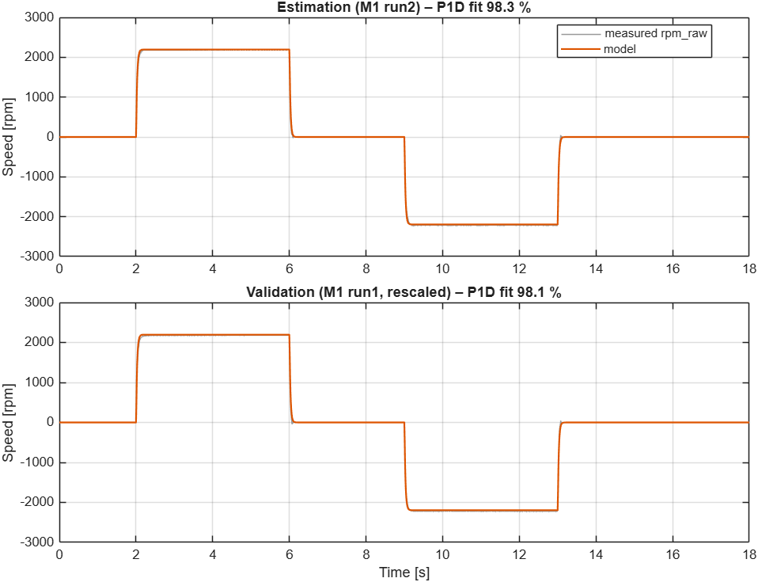
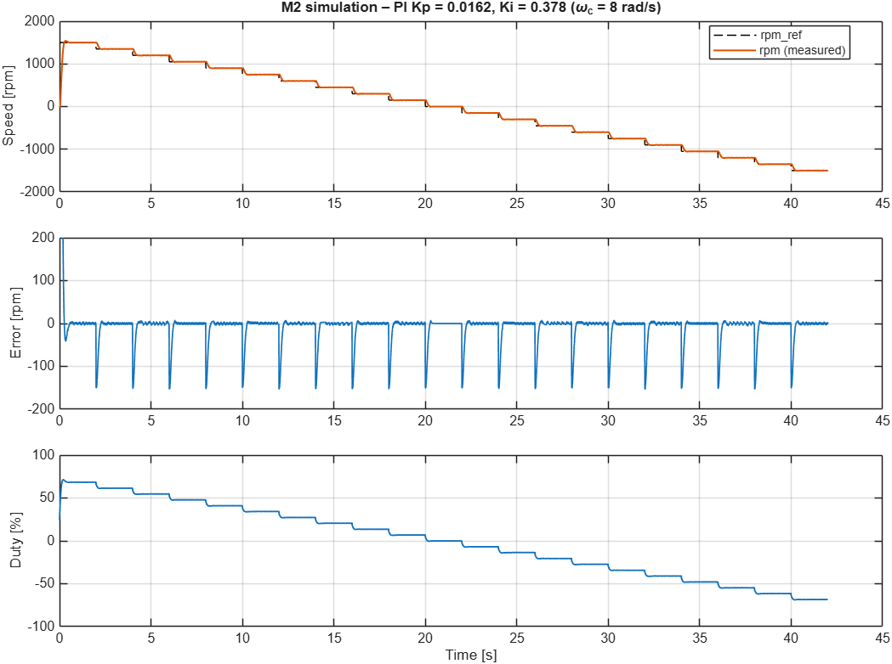
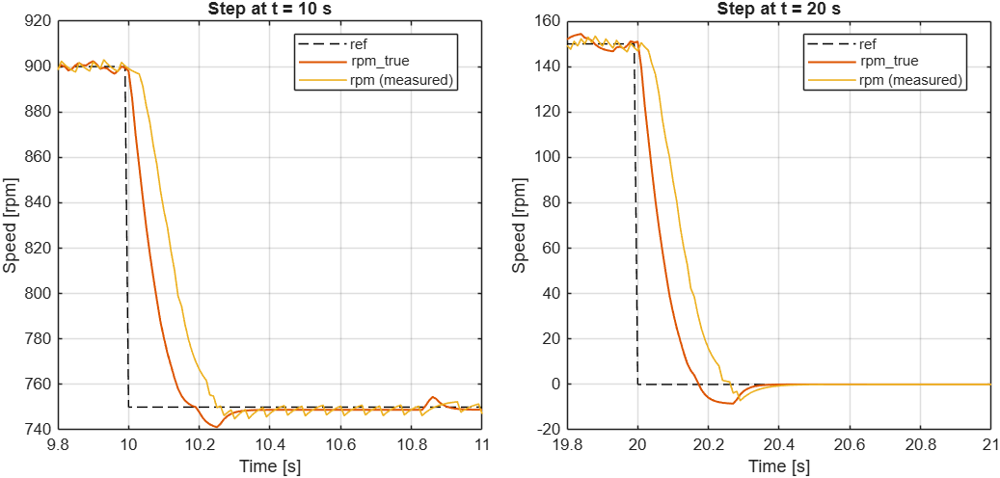

# M2 – Plant identification and PI design in simulation

**Model:** `01_Implementation/DCMotor_M2_PISim.slx`
**Scripts:** `identify_DCMotorPlant.m` → `DCMotorPlant_ID.mat`, `design_SpeedPI.m` → `SpeedPI_design.mat`
**Tests:** `SpeedController.feature` (model_test, Simulink Test)

## 1. Plant identification (System Identification Toolbox, `procest`, Focus = simulation)

Input: duty [%]; output: `rpm_raw` (calibrated, before the measurement filter). Estimation used M1 run2; validation used M1 run1 (rescaled by `Enc_Kcal`), an independent run.

| Model | Estimation fit | Validation fit |
|---|---|---|
| P1 | 98.1 % | 97.9 % |
| **P1D (selected)** | **98.3 %** | **98.1 %** |
| P2D | 97.6 % | 97.5 % |

**Plant:** `G(s) = 21.95 / (0.0242 s + 1) · e^(−0.0043 s)` [rpm/%], so the speed responds quickly with a 24 ms time constant.
Fitted separately, the positive and negative steps give K = 21.78 / 22.11 rpm/% and τ = 23.9 / 24.5 ms (< 2 % asymmetry), so a linear model is adequate.
Residuals aren't fully white (this is step data with encoder quantisation), but the 98 % simulation fit on independent data is what matters for control design.

Discretised (ZOH, Ts = 10 ms, delay absorbed): `G(z) = (4.606 z + 2.823) / (z² − 0.6615 z)`.

## 2. Simulation model `DCMotor_M2_PISim`

`SpeedReference` → `SpeedController` → `PWM_Quantizer` (100/255 %) → `MotorPlant` G(z) → `SpeedSensorModel` → feedback

| Component | Implementation |
|---|---|
| `SpeedReference.slx` (subsystem reference) | `sat(1500 − 150·floor(t/2), −1500, 1500)`: 21 levels, 42 s |
| `SpeedController.slx` (subsystem reference) | `rpm_err` → **Discrete PID Controller block, PI**, parallel, Forward Euler, Ts, output limit ±`Duty_Max` (100 %), **clamping anti-windup** |
| `SpeedSensorModel` | Encoder model: position accumulation → floor (count quantisation) → difference → `Enc_RPMGain` → same 40 ms LPF as `EncoderToRPM` |

`SpeedReference` and `SpeedController` are used unchanged in the M3 hardware model.

## 3. PI tuning (`design_SpeedPI.m`)

Loop for tuning: `L = C · G(z) · H(z)`, with `H = z⁻¹ · LPF` (encoder difference delay plus measurement filter). `pidtune` (PI, PM target 65°, reference tracking) was run for ωc = 8 … 22 rad/s, and every candidate was simulated on the full staircase (fast restart sweep, `SimulationInput`):

| ωc [rad/s] | Kp | Ki | PM [°] | GM [dB] | max OS [%] | max settling [s] | first step OS [%] | Pass |
|---|---|---|---|---|---|---|---|---|
| **8** | **0.01617** | **0.3778** | **65.0** | **15.3** | **6.4** | **0.28** | **4.1** | **✔ selected** |
| 10 | 0.02537 | 0.4595 | 65.0 | 13.1 | 7.7 | 0.21 | 5.9 | ✔ |
| 12 | 0.03444 | 0.5226 | 65.0 | 11.3 | 14.0 | 0.17 | 12.1 | ✘ OS |
| 15 | 0.04746 | 0.5674 | 65.0 | 9.2 | 27.0 | 0.25 | 25.2 | ✘ |
| 18 | 0.05937 | 0.5324 | 65.0 | 7.8 | 37.3 | 0.38 | 21.3 | ✘ |
| 22 | 0.07273 | 0.3256 | 65.0 | 6.7 | 43.3 | 1.12 | 20.7 | ✘ |

Overshoot and settling are measured on `rpm_true` for each 150 rpm step; settling is to within ±5 % of the step (±7.5 rpm). Above about 10 rad/s the encoder quantisation and filter lag cause overshoot that the linear margins don't predict.
Selection rule: the most robust (lowest ωc) candidate that settles in under 0.3 s, which is **ωc = 8 rad/s**. Its 15 dB gain margin leaves room for hardware differences such as friction, supply variation and model error. ωc = 10 rad/s is a faster fallback for M3.

**Gains in `DCMotorParams.m`: `Kp_Speed = 0.01617 %/rpm`, `Ki_Speed = 0.3778 %/(rpm·s)`.**

Staircase result (selected): steady-state RMS error 1.8 rpm (encoder quantisation noise), the 0 → 1500 rpm start saturates at about 70 % duty with only 4.1 % overshoot, there's no windup, and the zero crossing is smooth. Peak duty is about ±70 %, so there is about 30 % headroom.

## 4. Controller tests (`model_test`, `SpeedController.feature`)

Component under test: `DCMotor_M2_PISim/SpeedController`. Full compile (non-draft) with decision coverage:

| Scenario | Result |
|---|---|
| Zero error gives zero duty | ✔ |
| Proportional and integral action on constant error (P ≈ 1.6 %, I ≈ 37.8 %/s) | ✔ |
| Positive saturation at +100 % | ✔ |
| Negative saturation at −100 % | ✔ |
| Anti-windup: output turns negative within 100 ms after a 2 s saturated reversal | ✔ |

**5/5 scenarios, 12/12 assessments passed; execution coverage 100 % (6/6), decision coverage 100 % (6/6).**

## Gate 2 status

| Criterion | Status |
|---|---|
| 150 rpm steps settle within ≈ 0.5 s | ✔ max 0.28 s |
| Overshoot < 10 % | ✔ max 6.4 % |
| Full +1500 → −1500 sweep without windup | ✔ |
| Tests pass | ✔ 5/5, 100 % decision coverage |

## Update after M3 run1 (friction compensation)
Hardware run1 showed a 103 rpm overshoot when breaking away from standstill (static friction). After Gate 2 the following changed; see `M3_ClosedLoopResults.md` for details:
- `DCMotor_M2_PISim` gained a `MotorFriction` block (static + Coulomb friction, `Sim_FrictionEnable`).
- `SpeedController.slx` gained the `FrictionFF` subsystem. The PI Controller block is unchanged, except that its output limits are now external (`±Duty_Max − duty_ff`).
- `SpeedController.feature` was extended to 11 scenarios (all pass).

## Risks for M3 (hardware)
- **Low-speed friction / deadband:** the model was identified only from 100 % steps. Static friction near 0 rpm (the step at 20 s and ±150 rpm) can cause a slower response or a small limit cycle. The integrator compensates, but this needs checking on hardware.
- **Measured noise:** the real `rpm` noise was 1.6 rpm std in M1, similar to the simulated quantisation, so no extra filtering is planned.
