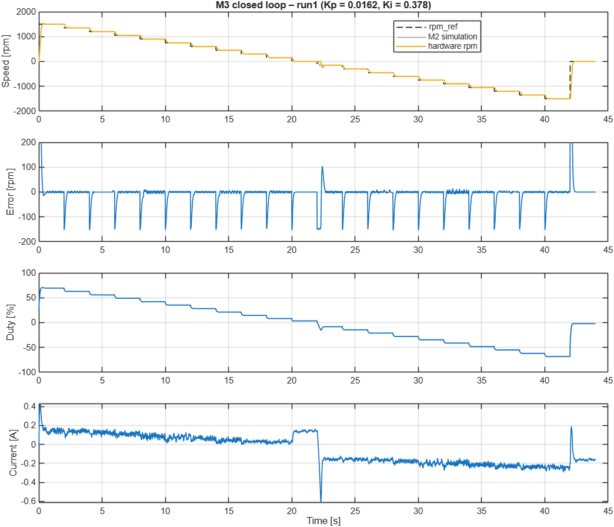
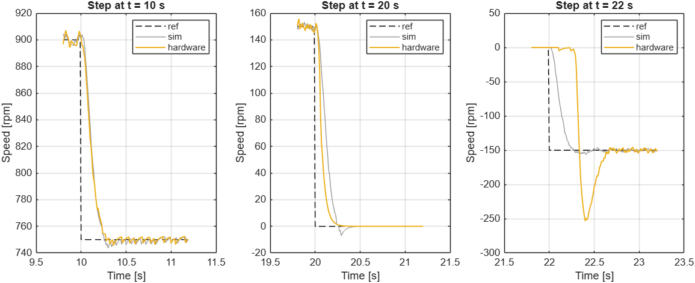
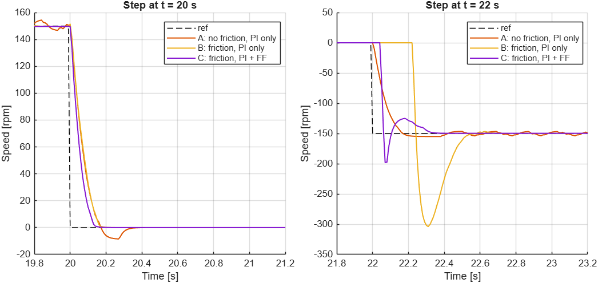
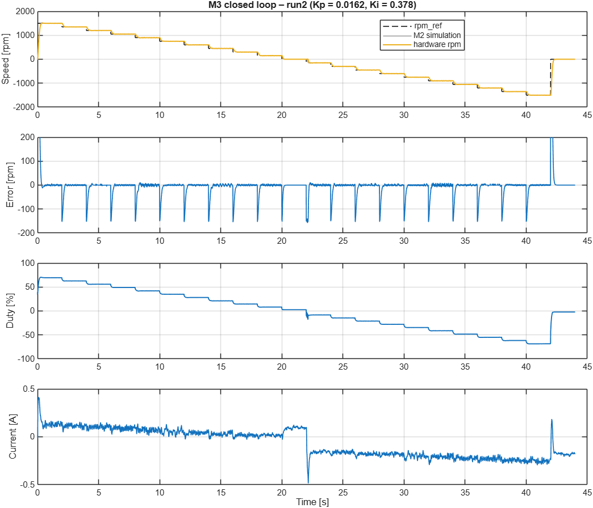
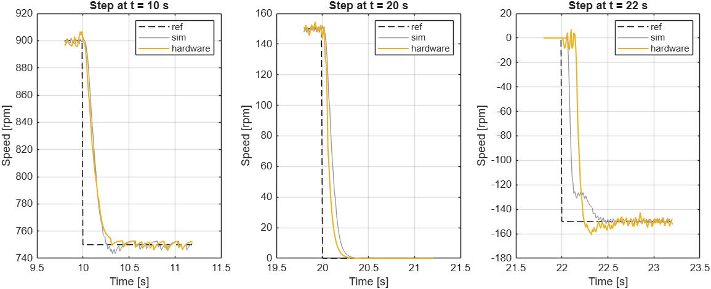

# M3 – Closed-loop speed control on hardware

**Model:** `01_Implementation/DCMotor_M3_ClosedLoopHW.slx`
**Analysis:** `01_Implementation/analyze_M3_ClosedLoop.m` → `M3_<run>_data.mat`, `M3_<run>.png`, `M3_<run>_steps.png`

## Model structure

| Block | Content |
|---|---|
| `SpeedReference` | Subsystem Reference (same as M2): +1500 → −1500 rpm, −150 rpm every 2 s |
| `StaircaseActive`, `RefStopGate` | Reference forced to 0 rpm after `Ref_StopTime` (42 s), so the motor is braked to standstill before the run stops at 44 s |
| `SpeedController` | Subsystem Reference (same as M2): **PI Controller block**, Kp = 0.01617, Ki = 0.3778, ±100 %, clamping anti-windup |
| `BTS7960_Driver` | `DC7960MDriver.slx` (unchanged) |
| `EncoderToRPM` | Feedback: calibrated `rpm` (Enc_Kcal = 0.8284, 40 ms LPF) |
| `CurrentSensor` | Logged only |

Target configuration is copied from the approved M1 model: Arduino Uno, Ts = 10 ms single-tasking, Monitor & Tune at 115200 baud, overrun LED on pin 13.
Memory: flash 25.8 KB (78.7 %), RAM 1486 B (72.6 %). Logged signals: `rpm_ref`, `rpm`, `rpm_raw`, `duty_cmd`, `current_A`.

## Run 1 – M2 gains, unchanged

| Metric | Result |
|---|---|
| Steady-state error (mean of last 0.5 s per level) | **max 0.6 rpm** |
| Speed ripple at constant speed (rms per level) | 1.4–4.4 rpm |
| Settling into ±30 rpm (150 rpm steps) | **max 0.56 s, mean 0.19 s** |
| Settling into ±7.5 rpm (±5 % of step) | mean 0.50 s; max 1.94 s, caused by single 8–13 rpm speed spikes late in the levels at 14, 26 and 32 s (not oscillation) |
| Overshoot on steps while turning | 3–13 rpm (2–9 %) |
| Start 0 → 1500 rpm (saturated) | 15.6 rpm overshoot (1.0 %), no windup |
| Peak duty | 70.5 % |
| Hardware vs. M2 simulation (rms over the staircase) | 12.2 rpm, so the steps match the simulation closely |

### Zero crossing / breakaway from standstill (t = 20–22.6 s)
- At the 0 rpm level the motor stops completely, held by static friction. Encoder counts stop, the error becomes exactly 0, and the integrator stays at the duty it had (+3.5 %). This is harmless.
- On the −150 rpm step the motor doesn't move until the integrator reaches **−15.3 % duty (breakaway at t = 22.28 s)**, about twice the −8.2 % needed to keep turning at −150 rpm.
- The excess integrator charge causes a **103 rpm overshoot (to about −253 rpm)**, which settles into ±30 rpm after 0.56 s. The linear plant model from M2 doesn't include static friction, so the simulation doesn't show this.

### Gate 3 status (run1)

| Criterion | Status |
|---|---|
| Steady-state error within ±30 rpm on every level | ✔ max 0.6 rpm |
| Settling < 1 s (±30 rpm) | ✔ max 0.56 s |
| No sustained oscillation | ✔ ripple ≤ 4.4 rpm rms |
| Smooth zero crossing | ⚠ the crossing itself is stable, but breakaway from standstill overshoots by 103 rpm (static friction) |

## Friction compensation (after run1, as requested)

### Friction identified from run1
The mean duty on each level fits `duty = 0.04525·ref + 1.024·sign(ref)` with a max residual of 0.65 %. Breakaway from standstill happened at about 14.6 % duty.

### Design (verified in simulation first)
- **Simulation friction model:** `DCMotor_M2_PISim/MotorFriction` (MATLAB Function) acts on the duty command. The motor stays stuck while |rpm| < 5 and |duty| ≤ 14 %; once moving, Coulomb friction removes 1.024 % in the direction of motion. With it, the simulation reproduces the hardware breakaway overshoot (154 rpm in simulation vs 103 rpm measured).
- **Root cause:** measurement lag. After breakaway, the measured speed trails the real speed by about 40–60 ms (encoder Δcount plus the 40 ms filter), while the motor's time constant is only 24 ms. Any duty above the roughly 8 % needed to keep turning at 150 rpm therefore shows up as overshoot before the PI can react.
- **Alternatives evaluated in simulation and rejected:**
  - Velocity feed-forward (0.04525 %/rpm): normal-step overshoot rose from 9 to 60–87 rpm, because the P term adds on top of an already-correct feed-forward.
  - Shorter speed filter (τ = 20 / 10 ms): breakaway overshoot only fell from 154 to 136 / 127 rpm, and noise went up.
- **Chosen:** friction-only feed-forward in `SpeedController/FrictionFF`, alongside the PI Controller block (which is unchanged):

  `duty_ff = FF_Enable · sign(rpm_ref) · (Duty_Coulomb + Duty_StictionBoost · (|rpm_meas| < Stick_RPM))`

  `Duty_Coulomb = 1.024 %`, `Duty_StictionBoost = 9 %`, `Stick_RPM = 5 rpm`, `FF_Enable = 1` (tunable in Monitor & Tune).
  The PI block's saturation is now external: `Duty_Max − duty_ff` / `−Duty_Max − duty_ff`. This keeps PI + feed-forward within ±100 % with correct clamping anti-windup. An outer `DutyLimit` saturation remains as a backstop.
- **Boost sweep with the friction model** (`verify_FrictionFF.m`): breakaway overshoot was 154 rpm at 0 %, 65 at 5 %, 61 at 7 %, **48 at 9 %** (0.09 s settling), 51 at 11 % and 102 at 15 %. Normal-step overshoot stays at 9 rpm for every boost value.

| Simulation case | Max step OS [rpm] | Breakaway OS [rpm] | Settling ±30 rpm [s] |
|---|---|---|---|
| A: no friction, PI only | 9.5 | 4.9 | 0.11 |
| B: friction, PI only | 153.9 | 153.9 | 0.46 |
| **C: friction, PI + friction FF** | 48.0 | 48.0 | 0.11 |
| D: no friction, PI + friction FF | 37.9 | 37.9 | 0.16 |

**Controller tests** (`SpeedController.feature`, full compile): **11/11 scenarios, 23/23 assessments passed**. The five original PI scenarios (now driven through `Meas` with `Ref = 0`, where the feed-forward is zero) plus six new ones: Coulomb FF in both directions, stiction boost in both directions, total output limit with FF, and anti-windup with FF on a full reversal. Execution coverage is 100 % and decision coverage 89 %. The two uncovered decisions belong to the backstop `DutyLimit` saturation, which the external PI limits keep from ever activating.

## Run 2 – PI + friction compensation

| Metric | Run 1 (PI only) | **Run 2 (PI + friction FF)** |
|---|---|---|
| Max steady-state error | 0.6 rpm | **0.5 rpm** |
| Breakaway 0 → −150 rpm overshoot (t = 22 s) | 103.0 rpm | **10.5 rpm** |
| Breakaway settling into ±30 rpm | 0.56 s | **0.21 s** |
| Max overshoot over all 150 rpm steps | 68.7 % | **7.3 %** |
| Settling into ±30 rpm, 150 rpm steps | max 0.56 s / mean 0.19 s | **max 0.21 s / mean 0.17 s** |
| Start 0 → 1500 rpm overshoot | 1.0 % | 0.8 % |
| Speed ripple (rms per level) | ≤ 4.4 rpm | ≤ 3.9 rpm |
| Peak duty | 70.5 % | 70.3 % |
| Hardware vs. M2 simulation (rms) | 12.2 rpm | 8.0 rpm |

The breakaway on hardware is better than the simulation predicted (10.5 vs 48 rpm), because the simulation friction model is harsher than the real motor (154 vs 103 rpm without compensation). As the boost switches off, the speed briefly wobbles by ±7 rpm (t ≈ 22.05–22.12 s). Duty at t = 22.01 s was −10.3 %, which confirms the boost was active in the deployed code.

## Gate 3 status (run2)

| Criterion | Status |
|---|---|
| Steady-state error within ±30 rpm on every level | ✔ max 0.5 rpm |
| Settling < 1 s (±30 rpm) | ✔ max 0.21 s |
| No sustained oscillation | ✔ ripple ≤ 3.9 rpm rms |
| Smooth zero crossing | ✔ breakaway overshoot 10.5 rpm (7 %), settling 0.21 s |

### Notes
- At the 0 rpm level (and after the run ends) the PI integrator holds a small residual duty (+2.7 % here) while static friction keeps the motor still. This is harmless and below the breakaway duty.
- Settling into the strict ±7.5 rpm band still occasionally reads 1–1.9 s, because of single 8–13 rpm speed spikes late in a level, not oscillation.
